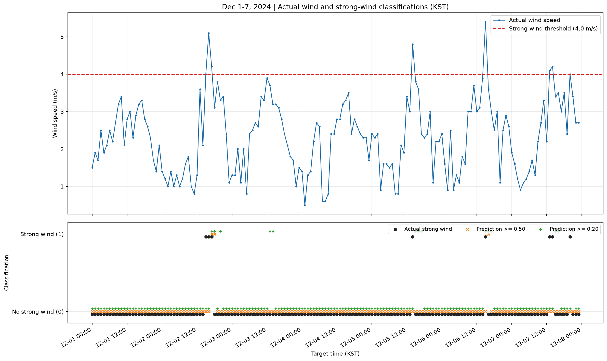

# 강풍 예측 분류 프로젝트

현재 시점과 과거 풍속 데이터를 사용해 1시간 뒤의 풍속이 강풍 기준을 넘는지를 분류하는 Python 프로젝트입니다.

## 1. 문제 정의

- 예측 시점: `prediction_time`
- 예측 대상 시점: `target_time`
- 강풍 기준: `target_wind_speed_ms >= 4.0 m/s`
- 분류 결과:
  - `1`: 강풍
  - `0`: 강풍이 아닌 상태

모든 데이터는 예측 시각과 정답 시각의 차이가 정확히 1시간인지 검증됩니다. 시간은 별도 변환 없이 CSV에 기록된 값을 KST로 사용합니다.

## 2. 사용 데이터

입력 파일은 `wind_dataset.csv`입니다.

| 컬럼 | 설명 |
|---|---|
| `prediction_time` | 예측 시각 |
| `target_time` | 예측 대상 시각 |
| `target_wind_speed_ms` | 1시간 뒤 실제 풍속 |
| `wind_speed_ms` | 현재 풍속 |
| `temperature_C` | 기온 |
| `humidity_pct` | 습도 |
| `wind_speed_1h_ago_ms` | 1시간 전 풍속 |
| `wind_speed_2h_ago_ms` | 2시간 전 풍속 |

- 전체 데이터 기간: 2023-01-01 03:00 ~ 2024-12-31 23:00
- 전체 행 수: 17,464행
- 학습 데이터: 2023-01-01 ~ 2024-11-30의 16,720행
- 평가 데이터: 2024년 12월의 744행
- 2024년 12월 실제 강풍: 39행

## 3. 모델 및 비교 방법

모델은 다음 5개 특징을 사용한 로지스틱 회귀입니다.

- `wind_speed_ms`
- `temperature_C`
- `humidity_pct`
- `wind_speed_1h_ago_ms`
- `wind_speed_2h_ago_ms`

학습 전에 `StandardScaler`로 특징을 표준화합니다.

평가에서는 다음 네 가지 예측 방법을 비교합니다.

| 방법 | 규칙 |
|---|---|
| 항상 0 | 모든 시점에서 강풍이 아니라고 예측 |
| 현재 풍속 기준 | 현재 풍속이 4.0 m/s 이상이면 강풍으로 예측 |
| 로지스틱 회귀(0.50) | 강풍 확률이 0.50 이상이면 강풍으로 예측 |
| 로지스틱 회귀(0.20) | 강풍 확률이 0.20 이상이면 강풍으로 예측 |

임계값을 낮출수록 강풍을 더 많이 감지할 가능성이 있지만 오경보도 증가할 수 있습니다.

## 4. 실행 방법

Windows 환경의 가상환경을 기준으로 실행합니다.

```powershell
python -m venv .venv
.\.venv\Scripts\python.exe -m pip install scikit-learn
.\.venv\Scripts\python.exe classify_wind.py
```

스크립트는 다음 두 CSV와 콘솔 요약을 생성합니다.

- `classification_predictions.csv`: 2024년 12월의 실제값, 예측확률 및 각 예측 방법 결과
- `classification_scores.csv`: 방법별 혼동행렬 지표와 정확도

## 5. 평가 결과

평가 구간은 2024년 12월이며 전체 744행 중 실제 강풍은 39행입니다.

| 방법 | 적중 | 놓침 | 오경보 | 정확도 | 정밀도 | 재현율 |
|---|---:|---:|---:|---:|---:|---:|
| 항상 0 | 0 | 39 | 0 | 94.7581% | 해당없음 | 0.00% |
| 현재 풍속 >= 4.0 m/s | 9 | 30 | 30 | 91.9355% | 23.0769% | 23.0769% |
| 로지스틱 회귀(확률 >= 0.50) | 4 | 35 | 6 | 94.4892% | 40.00% | 10.2564% |
| 로지스틱 회귀(확률 >= 0.20) | 15 | 24 | 41 | 91.2634% | 26.7857% | 38.4615% |

- **정밀도**: 강풍이라고 예측한 경우 중 실제 강풍의 비율
- **재현율**: 실제 강풍 중 모델이 맞춘 비율
- 정확도는 강풍이 드문 데이터 특성상 높게 나오더라도 강풍 탐지 성능을 충분히 나타내지 못할 수 있습니다.

기본 임계값 0.50은 오경보를 줄이지만 강풍 재현율이 낮습니다. 임계값 0.20은 강풍을 15회 적중해 재현율을 높이지만 오경보도 41회로 증가합니다.

## 6. 시각화



`strong_wind_december.png`는 평가 구간의 일부를 실제 풍속과 강풍 기준선, 실제 강풍 및 두 로지스틱 회귀 임계값의 예측과 함께 나타냅니다.

## 7. 데이터 검증 규칙

스크립트는 다음 항목을 검증합니다.

- 필수 CSV 컬럼 존재 여부
- 각 행의 `prediction_time`과 `target_time`이 정확히 1시간 차이인지 여부
- `prediction_time`의 오름차순
- `target_time`의 오름차순
- 학습 및 평가 구간의 데이터 존재 여부
- 모든 비교 방법이 동일한 평가 행 수와 실제 정답을 사용하는지 여부
